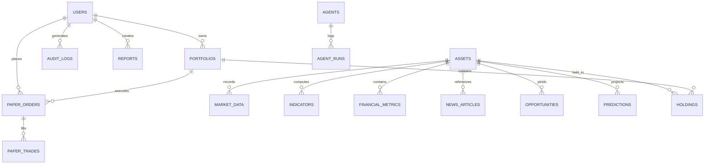

# TradeMind AI Database Architecture & Schema

The system supports both PostgreSQL and SQLite (with automatic migration detection).

### Relational Schema Design

### Table Definitions

1. **users**: `id`, `name`, `email`, `password_hash`, `role`, `created_at`
2. **assets**: `id`, `symbol`, `name`, `exchange`, `asset_type`, `currency`, `is_active`
3. **market_data**: `id`, `asset_id`, `timestamp`, `open`, `high`, `low`, `close`, `volume`
4. **indicators**: `id`, `asset_id`, `indicator_type`, `value`, `params_json`, `timestamp`
5. **financial_metrics**: `id`, `asset_id`, `metric_name`, `value`, `period`, `report_date`
6. **news_articles**: `id`, `asset_id`, `title`, `source`, `url`, `published_at`, `sentiment_score`, `summary`
7. **agents**: `id`, `name`, `description`, `status`, `last_run_at`, `total_runs`, `success_rate`
8. **agent_runs**: `id`, `agent_id`, `asset_id`, `status`, `input_data`, `output_data`, `execution_time_ms`, `timestamp`
9. **opportunities**: `id`, `asset_id`, `signal`, `score`, `confidence`, `entry_price`, `target_price`, `stop_loss`, `evidence_json`, `created_at`
10. **predictions**: `id`, `asset_id`, `model_name`, `forecast_horizon`, `predicted_price`, `price_low`, `price_high`, `confidence`, `created_at`
11. **portfolios**: `id`, `user_id`, `name`, `cash_balance`, `initial_balance`, `currency`, `created_at`
12. **holdings**: `id`, `portfolio_id`, `asset_id`, `quantity`, `average_buy_price`, `current_price`, `unrealized_pnl`
13. **paper_orders**: `id`, `user_id`, `portfolio_id`, `asset_id`, `order_type`, `side`, `quantity`, `price`, `status`, `created_at`
14. **paper_trades**: `id`, `order_id`, `execution_price`, `executed_quantity`, `fees`, `slippage`, `executed_at`
15. **risk_assessments**: `id`, `asset_id`, `risk_score`, `volatility_annualized`, `max_drawdown_pct`, `recommended_position_pct`, `stop_loss_distance_pct`, `created_at`
16. **backtests**: `id`, `user_id`, `strategy_name`, `symbol`, `start_date`, `end_date`, `total_return_pct`, `win_rate_pct`, `max_drawdown_pct`, `sharpe_ratio`, `trades_count`, `created_at`
17. **reports**: `id`, `user_id`, `report_type`, `title`, `content_json`, `created_at`
18. **audit_logs**: `id`, `user_id`, `action`, `resource`, `details_json`, `ip_address`, `timestamp`
